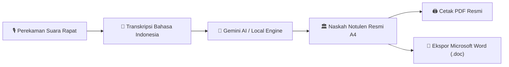
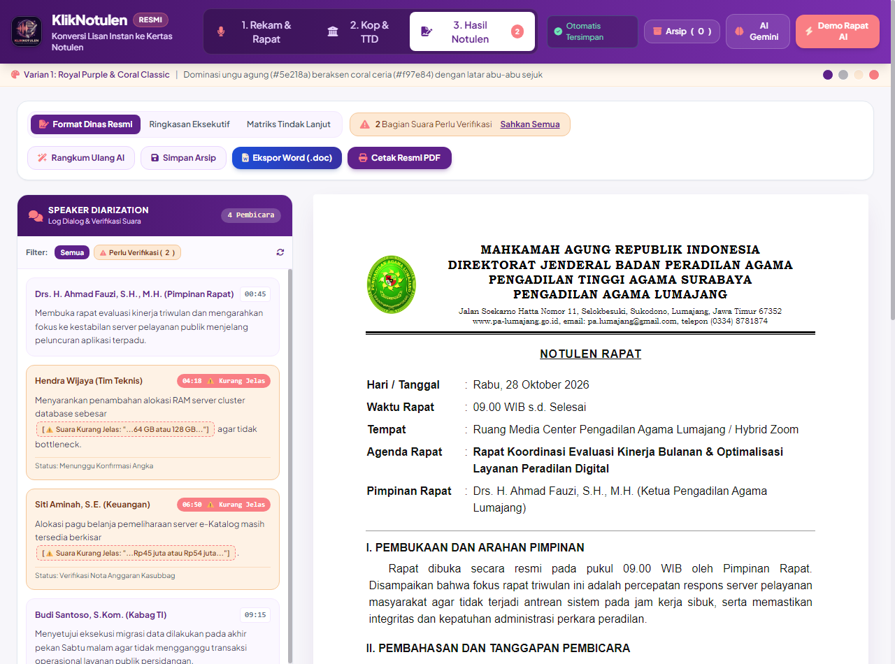
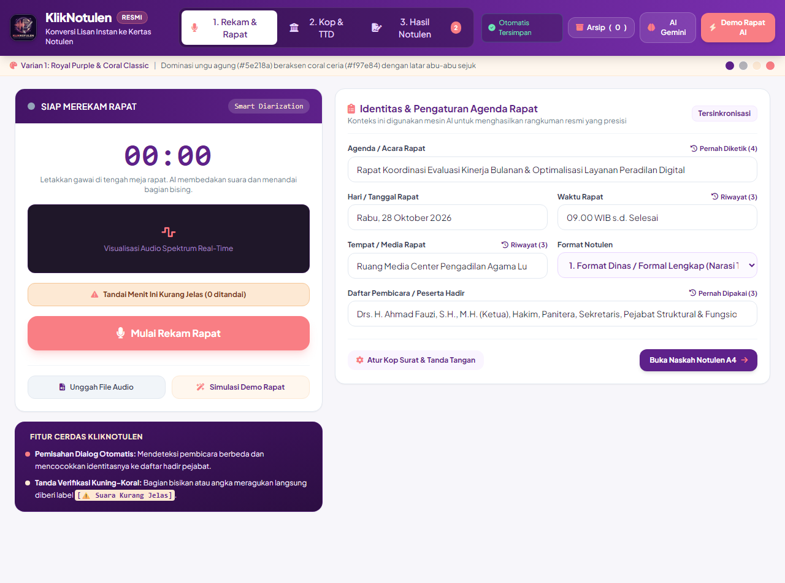
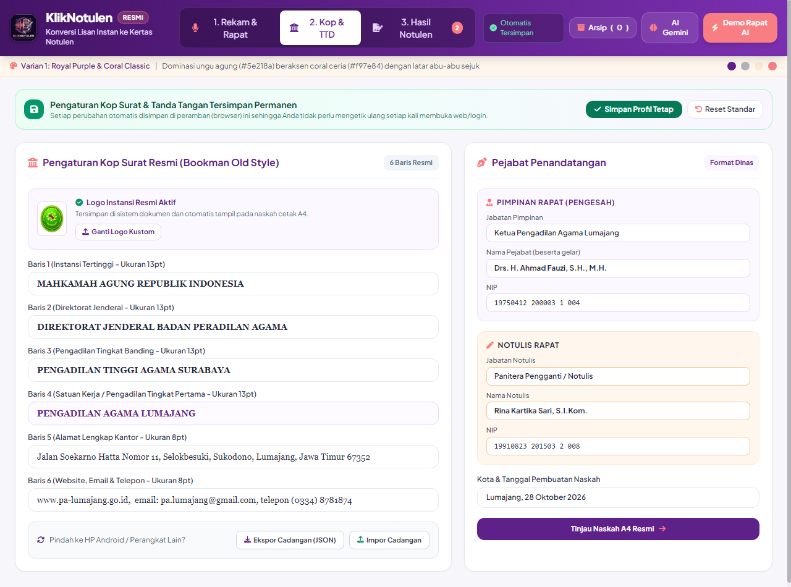
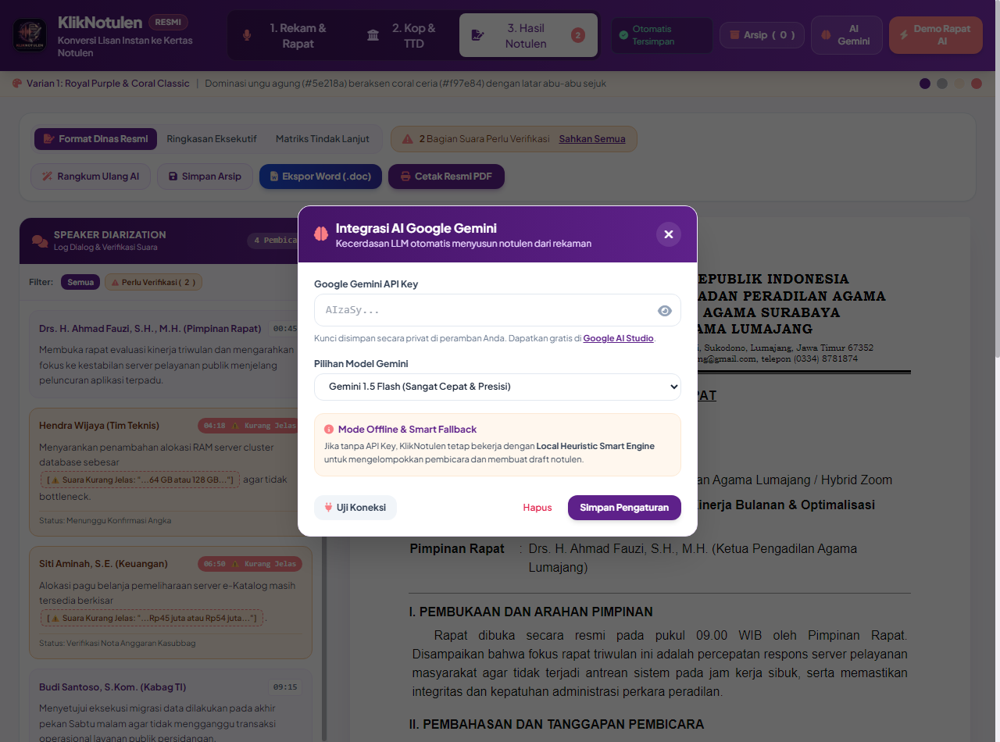
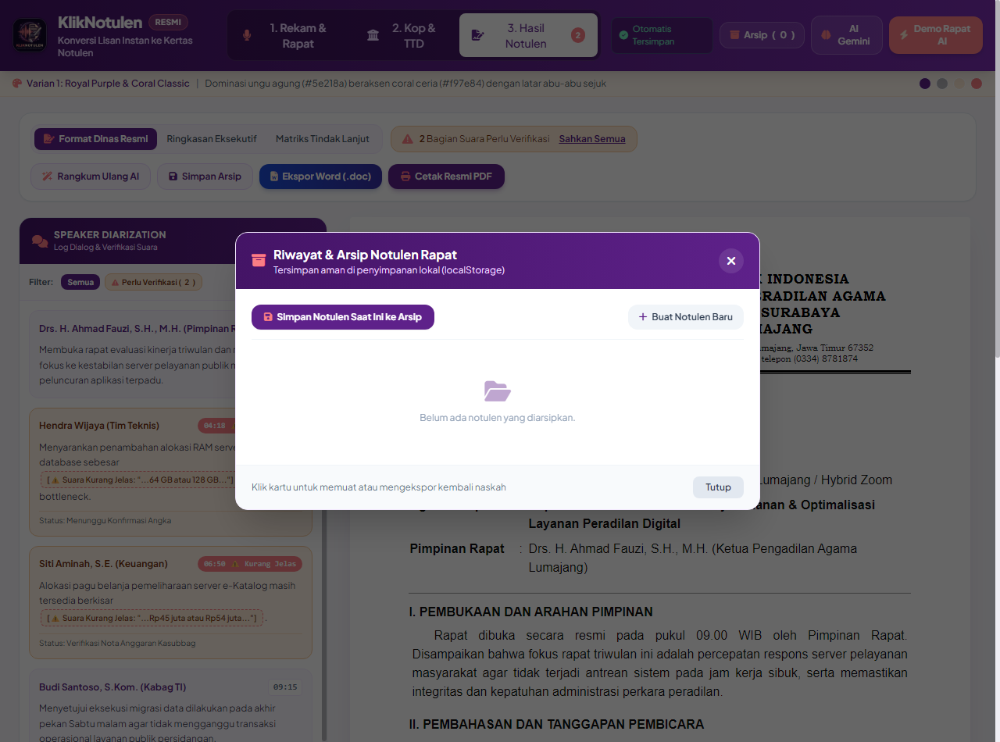
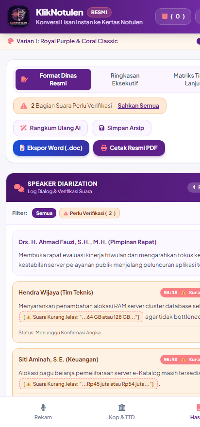

# 📘 BUKU PANDUAN PENGGUNA RESMI (USER MANUAL BOOK)
# KLIKNOTULEN - APLIKASI NOTULEN RAPAT PINTAR & FORMAT DINAS RESMI A4

**Versi:** 2.0  
**Tautan Aplikasi Online:** [https://kliknotulen.vercel.app/](https://kliknotulen.vercel.app/)  
**Repositori Kode Sumber:** [github.com/kecutelektronik-ai/kliknotulen](https://github.com/kecutelektronik-ai/kliknotulen)  
**Terakhir Diperbarui:** Oktober 2026

---

## DAFTAR ISI
1. [BAB 1: PENDAHULUAN & GAMBARAN UMUM](#bab-1-pendahuluan--gambaran-umum)
2. [BAB 2: AKSES DAN TAMPILAN UTAMA APLIKASI](#bab-2-akses-dan-tampilan-utama-aplikasi)
3. [BAB 3: PANDUAN PEREKAMAN SUARA & AGENDA RAPAT (TAB 1)](#bab-3-panduan-perekaman-suara--agenda-rapat-tab-1)
4. [BAB 4: PENGATURAN KOP SURAT & PEJABAT PENANDATANGAN (TAB 2)](#bab-4-pengaturan-kop-surat--pejabat-penandatangan-tab-2)
5. [BAB 5: INTEGRASI KECERDASAN BUATAN (AI GOOGLE GEMINI)](#bab-5-integrasi-kecerdasan-buatan-ai-google-gemini)
6. [BAB 6: HASIL NASKAH RESMI A4, CETAK PDF & EKSPOR WORD (TAB 3)](#bab-6-hasil-naskah-resmi-a4-cetak-pdf--ekspor-word-tab-3)
7. [BAB 7: PENGELOLAAN RIWAYAT & ARSIP NOTULEN LOKAL](#bab-7-pengelolaan-riwayat--arsip-notulen-lokal)
8. [BAB 8: PANDUAN PENGGUNAAN DI HP / SMARTPHONE ANDROID](#bab-8-panduan-penggunaan-di-hp--smartphone-android)
9. [BAB 9: PEMECAHAN MASALAH (TROUBLESHOOTING & FAQ)](#bab-9-pemecahan-masalah-troubleshooting--faq)

---

## BAB 1: PENDAHULUAN & GAMBARAN UMUM

### 1.1 Mengenal KlikNotulen
**KlikNotulen** adalah aplikasi web modern (*Local-First Web Application*) yang dirancang khusus untuk mempermudah pekerjaan notulis rapat di instansi pemerintah, pengadilan, BUMN, lembaga swasta, maupun organisasi. 

Aplikasi ini mengintegrasikan perekaman suara digital berkecepatan tinggi, transkripsi percakapan bahasa Indonesia langsung (*Real-time Speech-to-Text*), penyusunan naskah cerdas berbasis **Google Gemini AI**, serta pencetakan lembar dinas resmi berstandar **Kertas A4 (210 mm x 297 mm)**.

### 1.2 Keunggulan Utama Aplikasi
1. **Keamanan & Kerahasiaan Data (Client-Side Privacy):** Tidak memerlukan database server luar (seperti SQL/Supabase). Seluruh rekaman suara, transkrip, dan naskah rapat tersimpan privat di peramban pengguna.
2. **Kop Surat Standar Dinas (Bookman Old Style):** Dilengkapi template kop dinas 6 baris lengkap dengan logo instansi dan kolom tanda tangan pimpinan rapat serta notulis.
3. **Format Naskah Resmi A4 (Arial 12pt, Spasi 1.5):** Tata letak dokumen dioptimalkan secara presisi mengikuti tata naskah dinas resmi.
4. **Penyimpanan Permanen Otomatis:** Sekali menyetel Kop Surat dan Tanda Tangan, data akan tersimpan permanen di peramban sehingga tidak perlu mengetik ulang setiap kali membuka web.
5. **Dukungan Penuh HP Android:** Tampilan responsif dengan menu bilah navigasi bawah (*Bottom Navigation Bar*) serta dukungan pasang aplikasi layar utama (*Add to Home Screen*).

---

## BAB 2: AKSES DAN TAMPILAN UTAMA APLIKASI

### 2.1 Cara Membuka Aplikasi
Aplikasi dapat diakses langsung tanpa instalasi instalatur rumit melalui peramban web modern (**Google Chrome**, **Microsoft Edge**, atau **Mozilla Firefox**):
- **Akses Online (Vercel):** [https://kliknotulen.vercel.app/](https://kliknotulen.vercel.app/)
- **Akses Cadangan (GitHub Pages):** `https://kecutelektronik-ai.github.io/kliknotulen/`
- **Akses Offline:** Buka berkas `index.html` langsung dari komputer Anda.

### 2.2 Struktur Antarmuka Utama

Bilah atas (*Top Header*) KlikNotulen dilengkapi elemen navigasi berikut:
1. **Logo & Identitas:** Logo resmi KlikNotulen yang menyatu dengan gradien ungu dinas (*Royal Purple*).
2. **Tab 1 - Rekam & Rapat:** Panel perekam mikrofon, visualisasi gelombang suara (*waveform*), dan formulir identitas rapat.
3. **Tab 2 - Kop & TTD:** Pengaturan susunan 6 baris kop surat instansi, logo, data pejabat penandatangan, serta pencadangan profil.
4. **Tab 3 - Hasil Notulen:** Pratinjau lembar kertas A4 siap cetak beserta toolbar aksi (Cetak PDF, Ekspor Word, Salin Teks).
5. **Indikator Auto-Save:** Status penyimpanan otomatis ke memori lokal peramban.
6. **Tombol Arsip:** Membuka jendela riwayat notulen yang pernah disimpan.
7. **Tombol AI Gemini:** Mengatur API Key Google Gemini dan model kecerdasan buatan.
8. **Tombol Demo Rapat AI:** Tombol uji coba instan untuk mendemokan alur kerja rapat otomatis.

---

## BAB 3: PANDUAN PEREKAMAN SUARA & AGENDA RAPAT (TAB 1)

Tab pertama (**1. Rekam & Rapat**) berfungsi sebagai pusat kendali saat rapat berlangsung.

### 3.1 Langkah Memulai Perekaman
1. Klik menu **"1. Rekam & Rapat"** pada bilah navigasi.
2. Klik tombol besar **"Mulai Rekam Suara Rapat"** (berwarna ungu).
3. Saat peramban menampilkan jendela perizinan (*permission prompt*), pilih **"Izinkan" (Allow)** untuk memberikan akses mikrofon.
4. Kotak visualisasi (*Waveform Canvas*) akan menampilkan animasi gelombang suara naik-turun sesuai intonasi pembicara, dan pengukur waktu (*timer*) akan mulai berjalan.

### 3.2 Menandai Suara Ragu (*Unclear Audio Marker*)
Saat rapat berlangsung, adakalanya peserta berbicara terlalu cepat, menyebut angka yang rancu, atau suara terhalang derau:
- Klik tombol **"Tandai Suara Kurang Jelas / Ragu"** (berwarna krem dengan ikon peringatan).
- Sistem otomatis menyisipkan penanda stempel waktu (contoh: `[⚠️ Suara Kurang Jelas - Menit 04:18: "..."]`) ke dalam draft naskah agar notulis dapat memverifikasinya kembali sebelum dokumen disahkan.

### 3.3 Mengisi Metadata Rapat dengan Bantuan Riwayat Cerdas
Di sisi kanan panel rekaman, terdapat formulir agenda rapat yang tersambung dengan sistem kecerdasan buatan:
- **Agenda / Acara Rapat:** Masukkan tema atau pokok bahasan rapat.
- **Hari / Tanggal Rapat:** Terisi otomatis dengan hari dan tanggal saat ini.
- **Waktu Rapat:** Durasi atau jam pelaksanaan rapat (contoh: `09.00 WIB s.d. Selesai`).
- **Tempat / Media:** Lokasi fisik atau tautan hybrid (contoh: `Ruang Media Center / Hybrid Zoom`).
- **Format Notulen:** Pilihan format:
  1. *Format Dinas Formal Lengkap* (Narasi terstruktur standar kementerian/lembaga)
  2. *Format Eksekutif Ringkas* (Poin-poin inti & rencana aksi cepat)
  3. *Format Tabel Matriks* (Tabel agenda, target, dan PIC)
- **Daftar Pembicara / Peserta Hadir:** Daftar nama pejabat atau pemateri yang memimpin rapat.

> [!TIP]
> **Fitur Riwayat Otomatis (Autocomplete):**  
> Setiap kali Anda mengetik atau memilih data pada kolom Agenda, Waktu, Tempat, dan Peserta, sistem akan menyimpannya otomatis ke riwayat. Anda dapat mengklik tombol **"Pernah Diketik / Riwayat"** di atas kolom isian untuk memunculkan riwayat lama dan menekan **"Gunakan"** agar kolom terisi instan dalam 1 detik.

---

## BAB 4: PENGATURAN KOP SURAT & PEJABAT PENANDATANGAN (TAB 2)

Tab kedua (**2. Kop & TTD**) digunakan untuk menyesuaikan kop dinas dan pejabat penandatangan resmi sesuai instansi Anda.

### 4.1 Menyesuaikan 6 Baris Kop Surat (Standar Bookman Old Style)
1. **Baris 1:** Nama Lembaga / Instansi Tertinggi (Ukuran huruf 13pt tebal, contoh: `MAHKAMAH AGUNG REPUBLIK INDONESIA`).
2. **Baris 2:** Direktorat Jenderal / Badan Peradilan (Ukuran huruf 13pt tebal).
3. **Baris 3:** Pengadilan Tingkat Banding / Kantor Wilayah (Ukuran huruf 13pt tebal).
4. **Baris 4:** Satuan Kerja / Pengadilan Tingkat Pertama (Ukuran huruf 13pt tebal ungu).
5. **Baris 5:** Alamat Kantor Lengkap (Ukuran huruf 8pt).
6. **Baris 6:** Situs Web, Email Resmi, dan Nomor Telepon Kantor (Ukuran huruf 8pt).

### 4.2 Mengganti Logo Instansi
- **Logo Bawaan:** Sistem secara default memuat lambang dinas `logo_instansi.png`.
- **Upload Logo Kustom:** Klik tombol **"Ganti Logo Kustom"** lalu pilih berkas logo kantor Anda (format PNG transparan atau JPG). Logo baru akan langsung tersimpan permanen di memori lokal dan tampil otomatis pada naskah A4.
- **Reset Logo:** Jika ingin kembali ke logo awal, cukup klik tombol **"Reset ke Logo Asli"**.

### 4.3 Menentukan Pejabat Penandatangan
- **Pimpinan Rapat (Pengesah):** Masukkan Jabatan Pimpinan, Nama Lengkap beserta Gelar, dan NIP.
- **Notulis Rapat (Penyusun):** Masukkan Jabatan Notulis, Nama Lengkap beserta Gelar, dan NIP.
- **Kota & Tanggal Pembuatan Naskah:** Contoh: `Lumajang, 28 Oktober 2026`.

### 4.4 Penyimpanan Permanen & Cadangan Data
- **Simpan Profil Tetap:** Klik tombol hijau **"Simpan Profil Tetap"** untuk memastikan data kop surat dan pejabat terkunci aman di peramban Anda.
- **Reset Standar:** Mengembalikan susunan kop surat ke format bawaan Pengadilan Agama Lumajang.
- **Ekspor Cadangan (JSON):** Mengunduh seluruh profil kop surat, tanda tangan, dan riwayat naskah menjadi berkas kecil `.json`.
- **Impor Cadangan:** Digunakan jika Anda ingin memindahkan seluruh pengaturan instansi dari laptop ke **HP Android** atau komputer rekan kerja tanpa perlu mengetik ulang.

---

## BAB 5: INTEGRASI KECERDASAN BUATAN (AI GOOGLE GEMINI)

KlikNotulen dilengkapi dengan integrasi mutakhir **Google Gemini AI** untuk merangkum rekaman rapat menjadi naskah dinas siap cetak.

### 5.1 Memasukkan API Key Gemini
1. Klik tombol **"AI Gemini"** pada bilah atas.
2. Dapatkan kunci API secara gratis melalui portal resmi [Google AI Studio (aistudio.google.com/app/apikey)](https://aistudio.google.com/app/apikey).
3. Salin kunci API Anda (berawalan `AIzaSy...`) dan tempelkan ke kolom **Google Gemini API Key**.
4. Pilih model AI yang diinginkan:
   - **Gemini 1.5 Flash:** Model rekomendasi utama (respons sangat cepat, hemat kuota, dan akurat).
   - **Gemini 2.0 Flash:** Generasi terbaru untuk pemrosesan teks tingkat lanjut.
   - **Gemini 1.5 Pro:** Untuk rapat dengan pembahasan materi hukum atau teknis yang sangat padat.
5. Klik tombol **"Uji Koneksi"** untuk memastikan kunci berfungsi, lalu klik **"Simpan Pengaturan"**.

> [!NOTE]
> **Keamanan Kunci Privat:**  
> Kunci API Anda disimpan murni di peramban lokal Anda (*localStorage*) dan tidak pernah dikirim ke server pihak ketiga manapun selain langsung ke endpoint resmi Google Cloud.

### 5.2 Mode Offline & Local Smart Fallback
Jika Anda tidak memiliki API Key Gemini atau perangkat sedang tidak terhubung ke internet:
- KlikNotulen tetap dapat bekerja secara penuh menggunakan **Local Heuristic Smart Engine**.
- Mesin lokal ini akan memecah pembicara berdasarkan jeda kalimat dan menyusun draft naskah notulen dinas secara otomatis tanpa kuota internet.

---

## BAB 6: HASIL NASKAH RESMI A4, CETAK PDF & EKSPOR WORD (TAB 3)

Tab ketiga (**3. Hasil Notulen**) menampilkan lembar naskah resmi dinas berstandar cetak A4.

### 6.1 Struktur Naskah Notulen Dinas Resmi
Lembar naskah disusun rapi menggunakan tipografi resmi (font **Arial 12pt**, spasi **1.5**, margin dinas):
1. **Kepala Notulen (Kop Surat & Judul Notulen Rapat):** Memuat logo instansi, garis pembatas tebal ganda, nomor naskah, dan judul agenda.
2. **Tabel Identitas Pelaksanaan Rapat:** Hari, tanggal, waktu, tempat, dan pimpinan rapat.
3. **I. Pembukaan:** Narasi pembukaan rapat dan pengarahan pimpinan.
4. **II. Pembahasan dan Tanggapan Pembicara:** Uraian dialog dan pokok pandangan dari masing-masing pembicara.
5. **III. Kesimpulan Rapat:** Poin-poin kesepakatan dan hasil keputusan bersama.
6. **IV. Rencana Tindak Lanjut & Matriks PIC:** Tabel bergaris resmi berisi nomor, kegiatan, Penanggung Jawab (*PIC*), serta batas waktu (*deadline*).
7. **Kolom Tanda Tangan Resmi:** Tata letak dua sisi sejajar (Pimpinan Rapat di sebelah kanan, Notulis di sebelah kiri) lengkap dengan NIP.

### 6.2 Mengedit Langsung Isi Naskah
Seluruh teks di dalam kertas A4 bersifat **Content-Editable**:
- Anda dapat langsung mengklik kalimat manapun di dalam kertas putih untuk menambah, menghapus, atau mengedit teks seperti menggunakan Microsoft Word.
- Setiap ketikan Anda akan otomatis tersimpan dalam hitungan milidetik (*Auto-Save*).

### 6.3 Mengesahkan Suara Kurang Jelas (*Resolve Unclear*)
Jika terdapat tanda `[⚠️ Suara Kurang Jelas]`:
- Klik langsung teks kuning bertanda peringatan untuk mengetik koreksi kata yang benar.
- Atau klik tombol **"Sahkan Semua"** pada bilah notulen untuk menghapus semua penanda ragu dan menyetujui seluruh teks menjadi naskah definitif.

### 6.4 Toolbar Aksi & Ekspor
Di bagian atas lembar A4 tersedia tombol aksi:
- 🖨️ **Cetak Notulen A4 (PDF):** Membuka kotak dialog cetak peramban. Pilih tujuan *"Save as PDF"* dengan ukuran kertas A4.
- 📄 **Ekspor Microsoft Word (.doc):** Mengunduh berkas berekstensi `.doc` murni yang langsung bisa dibuka dan diedit di Microsoft Word kantor tanpa merusak format tabel dan kop surat.
- 📋 **Salin Naskah:** Menyalin seluruh teks notulen ke papan klip (*clipboard*) untuk ditempel ke email atau WhatsApp dinas.
- 💾 **Simpan ke Arsip:** Memasukkan naskah ini ke dalam daftar riwayat arsip lokal.

---

## BAB 7: PENGELOLAAN RIWAYAT & ARSIP NOTULEN LOKAL

### 7.1 Membuka Arsip
Klik tombol **"Arsip (x)"** pada bilah atas untuk membuka modal riwayat:
- Setiap kartu arsip menampilkan tanggal rapat, judul agenda, nama pimpinan rapat, dan stempel waktu penyimpanan.
- Klik ikon **Folder (Buka ke Editor)** pada kartu untuk memuat kembali naskah notulen lama ke lembar A4.
- Klik ikon **Tempat Sampah** untuk menghapus arsip yang sudah tidak diperlukan.

### 7.2 Membuat Naskah Notulen Baru
Jika rapat sebelumnya sudah selesai dan Anda ingin mencatat rapat baru:
1. Klik tombol **"Arsip"** $\rightarrow$ klik tombol **"Buat Notulen Baru"** (berwarna abu-abu dengan ikon plus).
2. Sistem akan membersihkan isi teks naskah dan mengisinya dengan format pembuka baru.
3. **Penting:** Susunan Kop Surat, Logo, dan Nama Pejabat Penandatangan Anda **TIDAK AKAN HILANG** dan tetap tersimpan rapi untuk rapat berikutnya.

---

## BAB 8: PANDUAN PENGGUNAAN DI HP / SMARTPHONE ANDROID

KlikNotulen didesain sepenuhnya ramah perangkat seluler (*Mobile-Friendly*), sehingga notulis dapat merekam dan memantau rapat langsung dari genggaman ponsel.

### 8.1 Rekomendasi Peramban di Android
Sangat direkomendasikan menggunakan **Google Chrome Android** karena peramban ini memiliki integrasi bawaan terbaik dengan mesin suara Google Speech-to-Text bahasa Indonesia.

### 8.2 Memasang Aplikasi ke Layar Utama (PWA WebAPK / Full-Bleed Icon)
Aplikasi kini sudah dilengkapi **Web App Manifest & Maskable Icon** resmi berstandar Android Adaptive Icon:
1. Hapus pintasan (*shortcut*) lama yang ada di layar utama HP Anda (jika sebelumnya dibuat sebelum pembaruan).
2. Buka `https://kliknotulen.vercel.app/` di Google Chrome HP Android Anda.
3. Ketuk ikon titik tiga (⋮) di pojok kanan atas browser.
4. Pilih menu **"Tambahkan ke Layar Utama" (Add to Home Screen)** atau **"Instal Aplikasi" (Install App)**.
5. Logo resmi KlikNotulen akan otomatis terpasang memenuhi ikon layar utama (*full-bleed*) dengan warna ungu dinas elegan tanpa ada bingkai putih dan berjalan dalam mode layar penuh (*standalone app*).

### 8.3 Navigasi Bilah Bawah (Mobile Bottom Bar)
Pada tampilan layar HP, menu utama berpindah ke bagian bawah layar untuk memudahkan jangkauan jempol:
- 🎙️ **Rekam:** Menuju panel kontrol rekaman suara dan isian agenda rapat.
- 🏛️ **Kop & TTD:** Menuju pengaturan logo dan nama pejabat.
- 📄 **Hasil A4:** Melihat lembar naskah dinas A4 siap cetak atau ekspor.

---

## BAB 9: PEMECAHAN MASALAH (TROUBLESHOOTING & FAQ)

| Kendala | Penyebab Umum | Solusi Cepat |
| :--- | :--- | :--- |
| **Perekaman suara tidak berjalan / muncul peringatan izin mikrofon** | Akses mikrofon diblokir oleh peramban. | Klik ikon gembok/setelan di samping alamat web pada bilah browser, ubah izin **Mikrofon** menjadi **"Izinkan" (Allow)**, lalu muat ulang halaman. |
| **Live Transkripsi tidak mengetik kata secara otomatis** | Menggunakan peramban yang tidak mendukung Web Speech API. | Beralihlah ke **Google Chrome** atau **Microsoft Edge** terbaru. |
| **Hasil cetak PDF terpotong atau margin bergeser** | Ukuran kertas di kotak dialog printer belum disetel ke A4. | Pada jendela cetak (*Ctrl + P*), pilih **Ukuran Kertas: A4**, margin: **Default**, dan centang **Background Graphics**. |
| **AI Gemini menampilkan pesan "Quota Exceeded"** | Kuota API Key gratis harian Google AI Studio telah mencapai batas. | Tunggu beberapa menit atau buat API Key baru secara gratis di [Google AI Studio](https://aistudio.google.com/app/apikey). |
| **Kop surat ter-reset saat membuka peramban lain** | Data tersimpan di memori lokal (*LocalStorage*) peramban sebelumnya. | Masuk ke Tab 2 (Kop & TTD), klik **Ekspor Cadangan (JSON)** dari peramban lama, lalu buka peramban baru dan klik **Impor Cadangan**. |

---

*Hak Cipta © 2026 KlikNotulen Team. Dilindungi Undang-Undang.*  
*Dirancang untuk Efisiensi Birokrasi dan Ketertiban Tata Kelola Rapat Dinas.*

